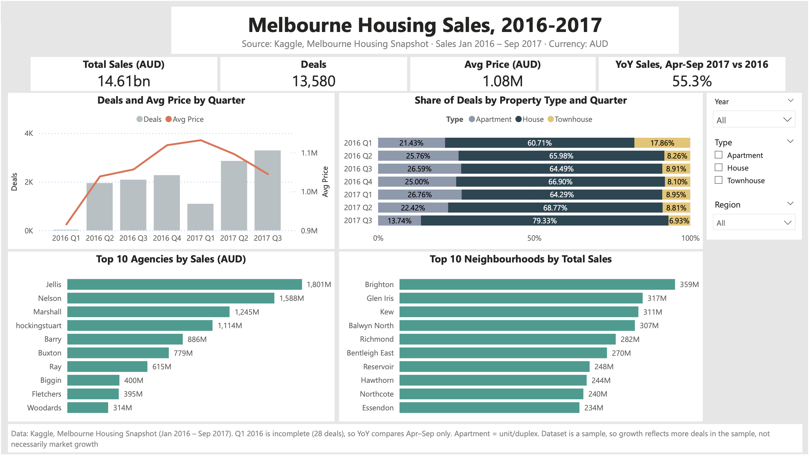
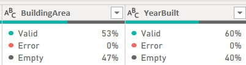
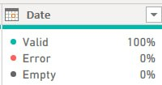
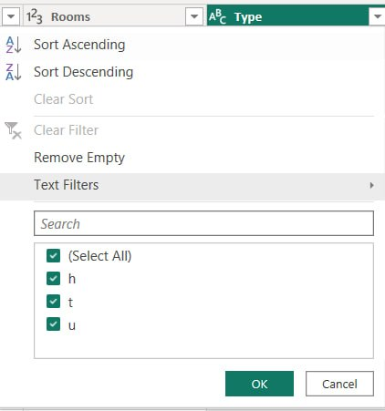
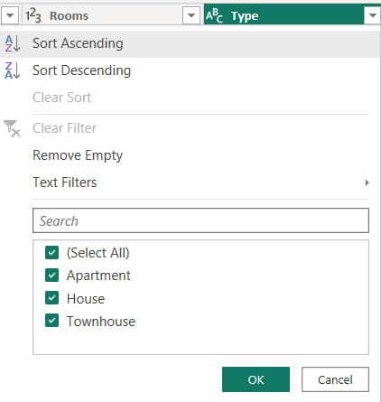
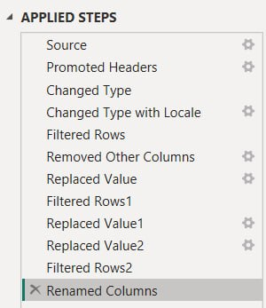
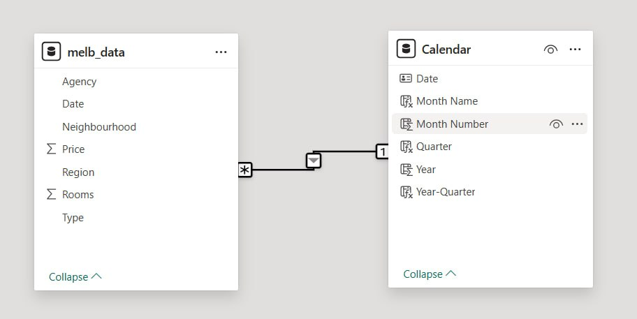

# Melbourne Housing Sales Dashboard (Power BI)

An interactive one-page Power BI dashboard analysing **13,580 residential property sales in Melbourne (Jan 2016 – Sep 2017)**: revenue, deal volume, average price, property types, top agencies and top neighbourhoods.



> **Tools:** Power BI Desktop · Power Query · DAX · Data modelling
> **Data:** Kaggle – Melbourne Housing Snapshot (`melb_data.csv`)
> **Currency:** AUD

---

## Business questions

1. How much revenue did the market generate, and how many deals were closed?
2. Which property type sells the most, and how does its price compare?
3. Which agencies bring in the most revenue?
4. Which neighbourhoods generate the most sales?
5. How did sales change in 2017 compared with 2016?

---

## Key insights

| # | Insight |
|---|---------|
| 1 | The sample contains **13,580 sales worth AUD 14.61 bn**, with an average price of **AUD 1.08 M**. |
| 2 | **Revenue growth is driven by deal volume, not price.** Q2: deals 1,949 → 2,859 (+47%) while average price moved only 1.04 M → 1.10 M (+5.5%). Q3: deals 2,087 → 3,290 (+58%), average price 1.06 M → 1.04 M (−1.1%). |
| 3 | Sales growth (Apr–Sep 2017 vs 2016) is **+55.3%**, but uneven by type: **House +63.5%**, **Townhouse +51.6%**, **Apartment +12.8%**. House share of deals rose to ~79% in Q3 2017. |
| 4 | **Houses are the most frequent and the most expensive type** (avg. 1.24 M), followed by townhouses (0.93 M) and apartments (0.61 M). |
| 5 | The agency market is **concentrated**: Jellis generates ~12% of all revenue (AUD 1.80 bn) and is about 5.7× larger than the 10th agency (Woodards, AUD 0.31 bn). |
| 6 | **Marshall** ranks 3rd by revenue with only 659 deals, because its average price is AUD 1.89 M. Its sales are concentrated in the top-5 neighbourhoods by revenue, where average prices are well above the market (Brighton ≈ 1.93 M, Glen Iris ≈ 1.62 M, Kew ≈ 1.76 M, roughly 1.5–1.8× the overall average of 1.08 M). |
| 7 | Top neighbourhoods by revenue: **Brighton, Glen Iris, Kew**. |

> The dataset is a **sample (snapshot)**, so growth in sales reflects more deals in the sample and is not proof of market growth.

---

## Dashboard

One page, built for a quick read:

- **KPI cards:** Total Sales, Deals, Avg Price, YoY Sales (Apr–Sep 2017 vs 2016)
- **Deals and Avg Price by Quarter** (columns + line, dual axis)
- **Share of Deals by Property Type and Quarter** (100% stacked)
- **Top 10 Agencies** and **Top 10 Neighbourhoods** by sales (Top N filter)
- **Slicers:** Year, Property Type, Region
- Consistent colour logic: teal = money, grey = deal volume, coral = price, three muted colours = property types

---

## Data

| Item | Value |
|------|-------|
| Source | Kaggle – Melbourne Housing Snapshot (`melb_data.csv`) – [Kaggle dataset page](https://www.kaggle.com/datasets/dansbecker/melbourne-housing-snapshot) |
| Rows | 13,580 |
| Columns | 21 in the original file, 7 kept for analysis |
| Period | 28 Jan 2016 – 23 Sep 2017 |
| License | [CC BY-NC-SA 4.0](https://creativecommons.org/licenses/by-nc-sa/4.0/) |

**Columns used:** `Suburb` (renamed **Neighbourhood**), `Regionname` (**Region**), `Type`, `Rooms`, `Price`, `SellerG` (**Agency**), `Date`.

---

## Data preparation (Power Query)

- Parsed `Date` using the **English (Australia)** locale (day first). Verified: 0% errors, correct range (28 Jan 2016 – 23 Sep 2017).
- Checked column profiling on the **entire data set** (not the default top 1000 rows).
- `BuildingArea` (47% empty) and `YearBuilt` (40% empty): **rows were not removed**, because deleting them would drop almost half of the real sales. Neither column is used in the analysis.
- `Landsize` excluded: for apartments it describes the plot under the whole building, not the individual flat.
- Removed unnecessary columns, including `Address` and coordinates (no exact addresses in a public project).
- Renamed `Type` values: `h` → **House**, `u` → **Apartment**, `t` → **Townhouse** (using *Match entire cell contents*). Note: Apartment = unit/duplex in the original data.
- Renamed columns for readability (Neighbourhood, Region, Agency).

**Screenshots of the cleaning steps:**

| Missing values by column | Date parsed with the Australian locale |
|---|---|
|  |  |

| `Type` before | `Type` after |
|---|---|
|  |  |



---

## Data model

- **melb_data** – fact table (one row per sale)
- **Calendar** – date table, marked as a date table, one-to-many relationship `Calendar[Date]` → `melb_data[Date]`
- **_Measures** – table that holds all DAX measures



**Calendar table (DAX):**

```DAX
Calendar = CALENDAR( MIN( melb_data[Date] ), MAX( melb_data[Date] ) )

Year          = YEAR( Calendar[Date] )
Month Number  = MONTH( Calendar[Date] )
Month Name    = FORMAT( Calendar[Date], "MMM", "en-US" )   // sorted by Month Number
Quarter       = "Q" & QUARTER( Calendar[Date] )
Year-Quarter  = Calendar[Year] & " " & Calendar[Quarter]
```

---

## DAX measures

```DAX
Total Sales = SUM( melb_data[Price] )

Deals = COUNTROWS( melb_data )

Avg Price = DIVIDE( [Total Sales], [Deals] )

Sales PY =
CALCULATE( [Total Sales], SAMEPERIODLASTYEAR( 'Calendar'[Date] ) )

YoY % =
DIVIDE( ( [Total Sales] - [Sales PY] ), [Sales PY] )

YoY Apr-Sep =
VAR Sales2017 =
    CALCULATE(
        [Total Sales],
        Calendar[Year] = 2017,
        Calendar[Month Number] >= 4,
        Calendar[Month Number] <= 9
    )
VAR Sales2016 =
    CALCULATE(
        [Total Sales],
        Calendar[Year] = 2016,
        Calendar[Month Number] >= 4,
        Calendar[Month Number] <= 9
    )
RETURN
    DIVIDE( Sales2017 - Sales2016, Sales2016 )
```

**Why `YoY Apr-Sep`?** Q1 2016 contains only 28 deals, so a standard year-over-year comparison for Q1 2017 gives a meaningless result (+4,735%). The final KPI compares only April–September, where both years have full data, and it does not depend on the Year slicer.

---

## Limitations

- The data is a **sample**, not the full market; the number of deals reflects coverage as well as market activity.
- **Q1 2016 is incomplete** (28 deals) and Q3 2017 ends on 23 Sep.
- The period is short (about 20 months), prices are nominal (no inflation adjustment), and the data covers Melbourne only.
- The dip in Q1 2017 deals is visible but unexplained by this dataset (seasonality is only a hypothesis).
- Agency names are used as they appear in the dataset.
- Price per m² was not analysed because `BuildingArea` is missing for about half of the sales.

---

## Repository contents

```
melbourne-housing-sales-power-bi/
├── README.md
├── Melbourne_Real_Estate.pbix
├── Melbourne_Housing_Dashboard.pdf
└── images/
    ├── dashboard.png
    ├── data-model.png
    ├── column-quality.png
    ├── date-locale.png
    ├── type-before.png
    ├── type-after.png
    └── applied-steps.png
```

To open the report, download `Melbourne_Real_Estate.pbix` and open it in **Power BI Desktop**. The PDF shows the dashboard without Power BI.

---

## Skills demonstrated

- **Power Query:** profiling, locale-aware date parsing, replacing values, removing columns, documented cleaning decisions
- **Data modelling:** date table, one-to-many relationship, a dedicated measures table
- **DAX:** `CALCULATE`, `SAMEPERIODLASTYEAR`, `VAR/RETURN`, `DIVIDE`, `COUNTROWS`, calculated columns
- **Visualisation:** KPI cards, combo chart, 100% stacked chart, Top N filters, slicers, consistent layout and palette
- **Analytical thinking:** separating volume and price effects, sanity-checking numbers, stating limitations

---

## License and attribution

- **Data:** *Melbourne Housing Snapshot*, published on Kaggle ([dataset page](https://www.kaggle.com/datasets/dansbecker/melbourne-housing-snapshot)) under the [CC BY-NC-SA 4.0](https://creativecommons.org/licenses/by-nc-sa/4.0/) license.
- **Changes made:** columns removed, fields and values renamed, date column parsed (see *Data preparation*).
- **This project** (report file, screenshots and documentation derived from the data) is shared for educational and portfolio purposes under the same license, **CC BY-NC-SA 4.0**. It is not for commercial use.

---

## Author

**Inna Bieliai** – Data Analyst
[LinkedIn](https://www.linkedin.com/in/inna-bieliai/) · [GitHub](https://github.com/inna-bieliai)
